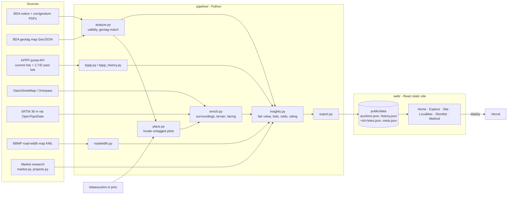

# Architecture

## Why this shape
- **Static site, precomputed data.** The auction changes a few times a year, so all analysis runs offline in Python, and the browser only reads two JSON files (about 200 KB gzipped). There is no server to run, Vercel hosting is free, and it's fast on phones.
- **One folder per auction.** `pipeline/auctions/<id>/` holds that auction's notice rows and geotag file. `python run.py <id>` runs every step and publishes `web/public/data/<id>/`. The website routes everything under `/a/<id>/…`, so past and future auctions sit side by side.
- **Untagged plots are placed by evidence.** A per-site pin is used where one exists (bdaeauction.in pins match BDA polygons within ~2 m). Otherwise the plot goes beside the nearest-numbered mapped site in the same block, rotated to the block grid, on the side clear of OSM roads. Failing both, the locality point is nudged off roads. The site page says which method placed each plot.
- **Every estimate is labelled.** Model outputs are marked `*` in the UI. Missing inputs are estimated and never scored as a negative.

## Pipeline stages
| Script | Input | Output |
|---|---|---|
| `run.py` | auction id | runs every step below for `auctions/<id>/` |
| `analyze.py` | notice rows (`auctions/<id>/notice.py`), geotag GeoJSON | `data.json`: validity flags, geotag match, base pricing |
| `place.py` | `data.json`, per-site pins, OSM roads | positions and outlines for plots BDA did not geotag |
| `kppp.py` | KPPP search API | `kppp_live.json`: auction notice number per site |
| `kppp_history.py` | KPPP search + view APIs | `kppp_history.json`: past lots (status, base rate, date) |
| `enrich.py` | Overpass, OpenTopoData | `geo_extra.json`: nearest lake, drain, HT line, roads, etc.; elevation, slope, facing |
| `roadwidth.py` | BBMP road-width KML, OSM tags | `roads.json`: road width (mapped or estimated*), planned RMP width, FAR |
| `insights.py` | all of the above + `market.py`, `projects.py` | `data2.json`: fair value, likely bid, odds, yields, rating, findings, personas |
| `export.py` | `data2.json` | `web/public/data/<id>/sites.json`, `meta.json`; updates `auctions.json` |
| `export_history.py` | `kppp_history.json` | `web/public/data/history.json`: every past BDA round and lot |

## Models (summary)
- **Fair value** = locality realisable rate × usability × facing/road adjustment, capped by any earlier no-bid price (+10%, grown). Small plots on wide roads use the higher of residential value and shop-rent value.
- **Likely winning bid** = base × (1 + 10% … 65% by competition), calibrated to BDA's Dec 2021 result (+62% average over base), capped at the top of the resale range.
- **Competition** = locality demand, adjusted by BDA sell-through (KPPP), ticket size, usability, earlier no-bid rounds and re-listing.
- **Rating** = 30% value after the likely bid + 15% growth + 15% location + 15% usability + 15% confidence + 10% win odds; a serious red flag caps it at 5.

## Web app
- `src/lib/`: types, data loading (context), filters (URL-synced), rankings, shortlist (localStorage).
- Routes: `/a/<id>` (overview), `/a/<id>/explore`, `/a/<id>/site/<site>`, `/a/<id>/localities`, `/a/<id>/shortlist`, plus `/auctions`, `/history` and `/method`. `/` redirects to the newest auction.
- `src/pages/`:
  - Home: picks by ranking.
  - Explore: filters, list and map, with a list/map switch on mobile.
  - SitePage: a tabbed report with a rent calculator.
  - Localities.
  - Shortlist: saved sites and side-by-side compare.
  - History: past auctions.
  - Auctions.
  - Method.
- Maps: Leaflet with Esri World Imagery (satellite) and OpenStreetMap tiles. Both are free and need no API key.
- `vercel.json`: SPA rewrites and data caching.
